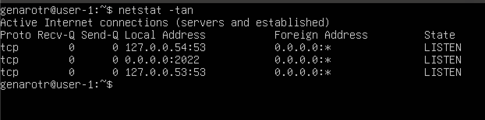
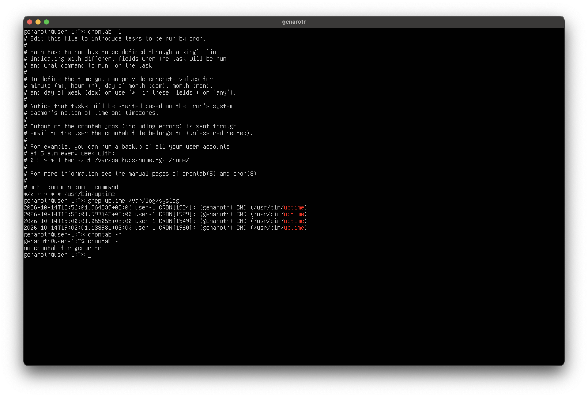

# Linux Administration Lab

Практический проект по базовому администрированию Linux, выполненный в рамках обучения в «Школе 21».

Развернул Ubuntu Server в виртуальной машине, настроил сеть и SSH, поработал с пользователями, службами, системными журналами и планировщиком cron. Ход работы и результаты проверок собраны в [полном отчёте со скриншотами](docs/report.md).

## Что реализовано

| Направление | Практическая работа | Инструменты |
| --- | --- | --- |
| Подготовка системы | Установка серверной ОС, обновление пакетов, настройка времени | Ubuntu Server, APT, timedatectl |
| Пользователи и доступ | Создание пользователя, настройка групп adm и sudo | useradd, usermod, sudo |
| Сеть | Статический IPv4, шлюз и DNS, проверка доступности узлов | Netplan, ip, networkctl, resolvectl, ping |
| Удалённый доступ | Настройка SSH на порту 2022, автозапуск и проверка после перезагрузки | OpenSSH, systemctl, netstat |
| Мониторинг | Анализ процессов, загрузки CPU и использования памяти | ps, top, htop |
| Дисковое пространство | Просмотр разделов и swap, анализ занятого места | fdisk, swapon, df, du, ncdu |
| Журналы | Поиск успешной авторизации и событий перезапуска SSH | less, grep, journalctl |
| Планировщик | Запуск uptime каждые две минуты, проверка журнала и удаление задания | cron, crontab |
| Редактирование файлов | Создание, сохранение, поиск и замена текста | Vim, Nano, MCEdit |

## Среда

- Виртуальная машина UTM на Mac с Apple Silicon.
- Ubuntu Server 24.04 LTS, архитектура ARM64, без графического интерфейса.
- Виртуальный диск: 40 GiB; корневая файловая система: ext4 на LVM.
- Сетевой интерфейс: enp0s1; адрес в учебной сети: 192.168.64.4/24.

## Результаты проверок

После перезагрузки сохранились статические сетевые настройки; проверка доступности `1.1.1.1` и `ya.ru` завершилась без потери пакетов. SSH принимал подключения на порту `2022`, а перезапуск службы подтверждён системным журналом.

Для задания cron в журнале зафиксированы четыре запуска `uptime` с интервалом две минуты. После удаления задания команда `crontab -l` подтвердила отсутствие пользовательского расписания.

### Проверка SSH

### Задание cron и подтверждение выполнения

## Материалы

- [Полный отчёт — 15 частей](docs/report.md)
- [Скриншоты выполнения](docs/img)
- [Пример сетевой конфигурации](examples/netplan.yaml)
- [Пример задания cron](examples/uptime.cron)

Примеры конфигурации восстановлены по отчёту. Сетевые адреса и имя интерфейса относятся к моей виртуальной машине; при повторении работы их нужно заменить на значения своей среды.

## Чему научился

Получил практику базового администрирования Linux: от установки системы до настройки удалённого доступа и поиска событий в журналах. Научился проверять результат настройки командами диагностики и сопоставлять показатели разных утилит. Проект стал основой для дальнейшего изучения DevOps и автоматизации инфраструктуры.

