## Part 1. Установка ОС

- Установлена Ubuntu 24.04.5 Server LTS без графического интерфейса.
- Версия системы проверена командой `cat /etc/issue`.

**Вывод команды `cat /etc/issue`:**

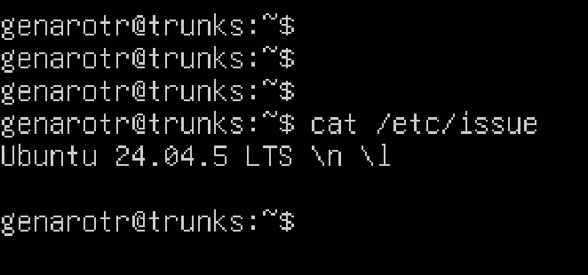

## Part 2. Создание пользователя

- Создан пользователь `user1`, отличный от пользователя, созданного при установке ОС.
- Команда `sudo useradd -m user1` создала пользователя и его домашний каталог.
- Пользователь добавлен в группу `adm` командой `sudo usermod -aG adm user1`.

**Создание пользователя:**

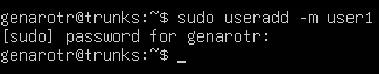

**Проверка пользователя и его групп:**

- Команда `cat /etc/passwd | grep user1` показывает запись пользователя в `/etc/passwd`.
- Команда `id user1` подтверждает членство в группе `adm`.

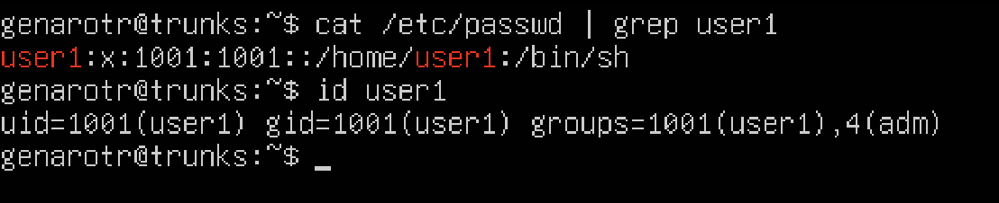

## Part 3. Настройка сети ОС

- Изменил имя машины командой `sudo hostname user-1`. Записал новое имя в `/etc/hostname` и в строке `127.0.1.1` файла `/etc/hosts`. После перезагрузки проверил командой `hostname`.
- Установил часовой пояс командой `sudo timedatectl set-timezone Europe/Moscow`.
- Вывел сетевые интерфейсы командой `ip -br link`. Интерфейс `lo` (loopback) нужен для сетевого взаимодействия программ внутри одной машины.
- Командой `ip -br addr show` узнал IP-адрес: `192.168.64.4/24`. Получение адреса по DHCP подтвердил командой `networkctl status enp0s1`. DHCP — Dynamic Host Configuration Protocol, протокол динамической настройки узла.
- Командой `curl ifconfig.me` определил внешний IP: `195.189.96.185`. Командой `ip route` определил внутренний шлюз: `192.168.64.1`.
- В файле `/etc/netplan/50-cloud-init.yaml` отключил DHCP и задал статические настройки: IP `192.168.64.4/24`, шлюз `192.168.64.1`, DNS `1.1.1.1` и `8.8.8.8`. Применил настройки командой `sudo netplan apply`.
- Перезагрузил виртуальную машину. Проверил IP и шлюз командой `ip route`, DNS — командой `resolvectl status enp0s1`. Заданные настройки сохранились.
- Проверил доступность `1.1.1.1` и `ya.ru` командой `ping`. В обоих случаях — `0% packet loss`.

**Пинг удалённых хостов:**

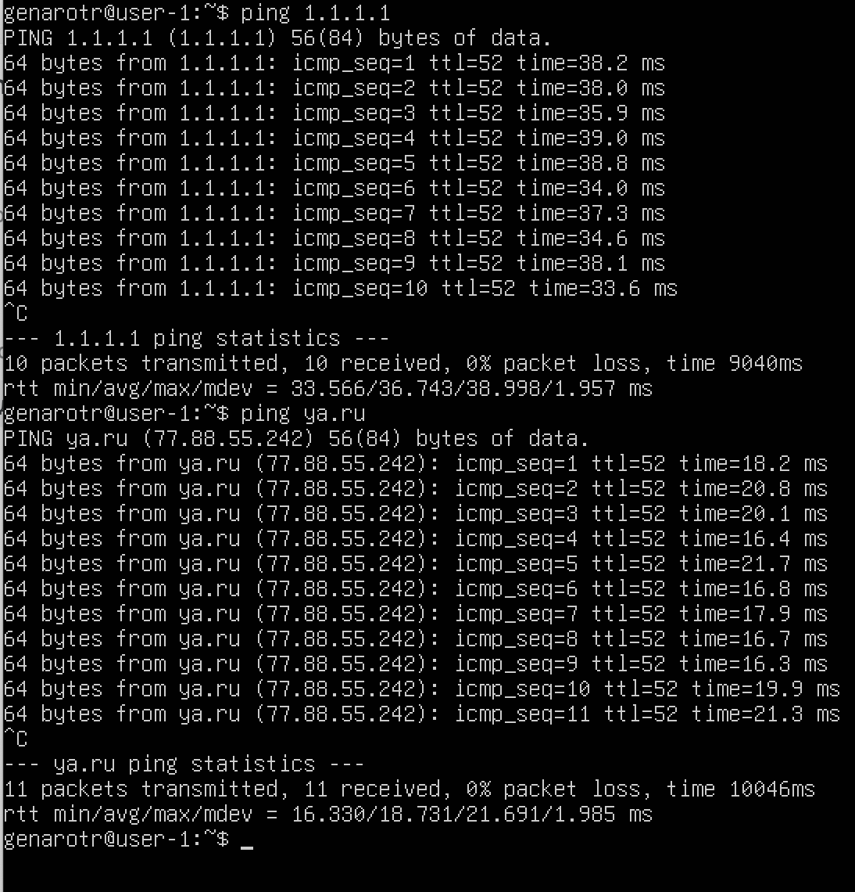

## Part 4. Обновление ОС

- Обновил список пакетов командой `sudo apt update`.
- Обновил системные пакеты командой `sudo apt upgrade`.
- Повторно выполнил `sudo apt upgrade`. Обновления отсутствуют: `0 upgraded, 0 newly installed, 0 to remove and 0 not upgraded`.

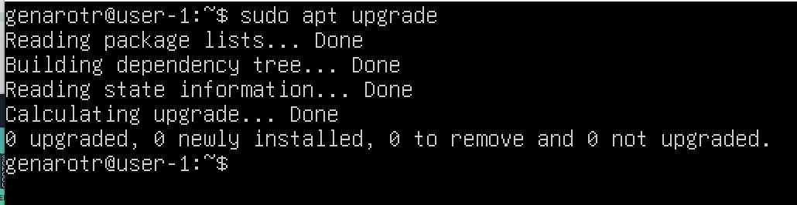

## Part 5. Использование команды sudo

- Добавил пользователя `user1` в группу `sudo` командой `sudo usermod -aG sudo user1`.
- Команда `sudo` позволяет выполнять команды от имени другого пользователя, по умолчанию — администратора root, если это разрешено настройками доступа.
- Переключился на `user1` командой `su - user1` и изменил hostname на `user-2` командой `sudo hostname user-2`.
- Проверил результат командой `hostname`.

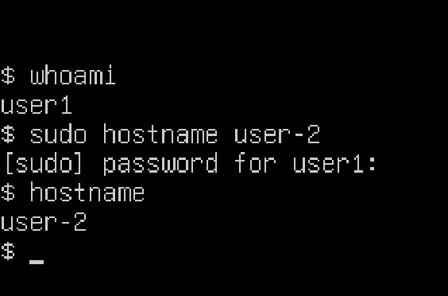

## Part 6. Установка и настройка службы времени

- Включил автоматическую синхронизацию времени командой `sudo timedatectl set-ntp true`.
- Командой `timedatectl` вывел местное время в часовом поясе `Europe/Moscow`.
- Выполнил `timedatectl show`. Значение `NTPSynchronized=yes` подтверждает синхронизацию времени.

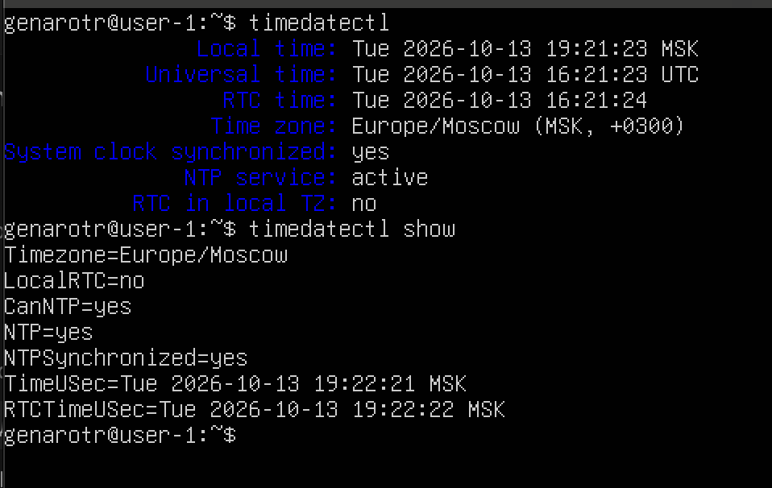

## Part 7. Установка и использование текстовых редакторов

- Установил Vim, Nano и MCEdit командой `sudo apt install vim nano mc`.
- В каждом редакторе создал файл с никнеймом `genarotr`.
- Затем заменил никнейм на `21 School 21` и вышел без сохранения.
- Повторно изменил текст, выполнил поиск слова `School` и замену на `Linux`.

### Vim

- Файл: `test_vim.txt`.
- Выход с сохранением: `Esc` → `:wq` → Enter.
- Выход без сохранения: `Esc` → `:q!` → Enter.
- Поиск: `/School` → Enter.
- Замена: `:%s/School/Linux/g` → Enter.

**Создание файла:**

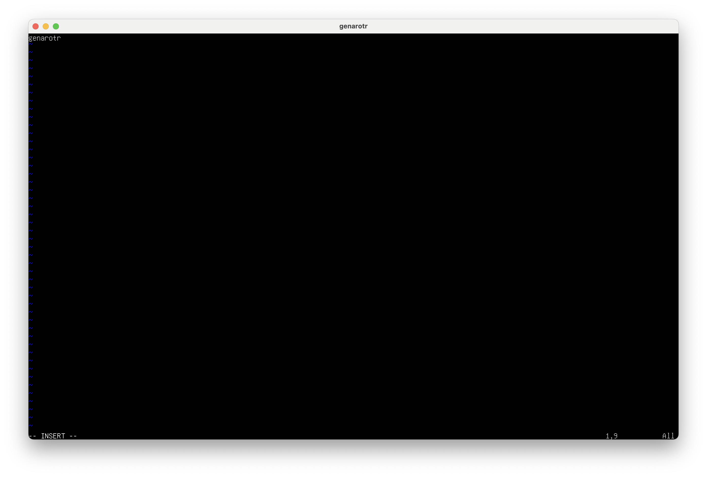

**Изменение перед выходом без сохранения:**

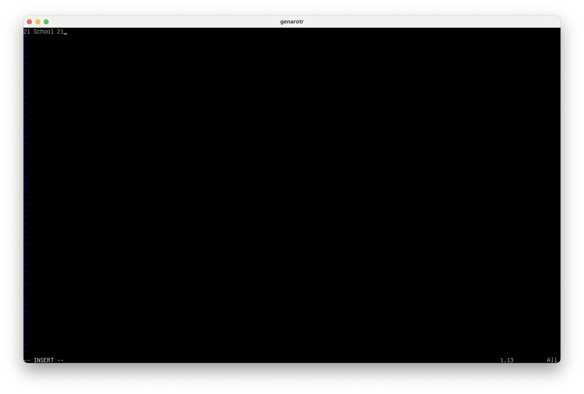

**Результат поиска:**

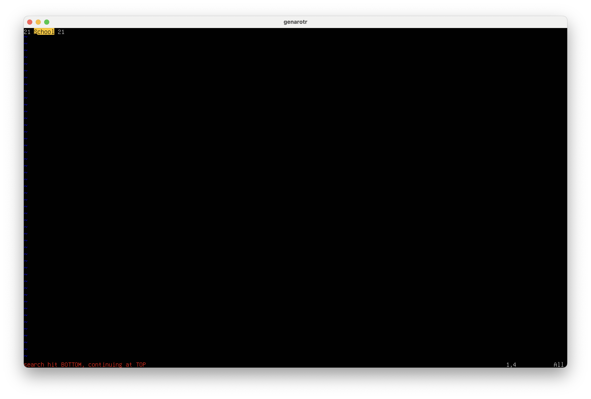

**Команда замены:**

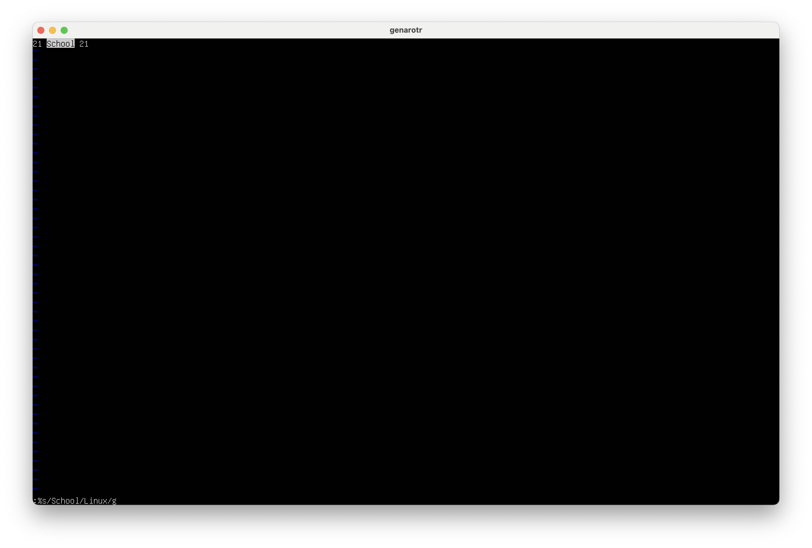

### Nano

- Файл: `test_nano.txt`.
- Выход с сохранением: Ctrl+O → Enter → Ctrl+X.
- Выход без сохранения: Ctrl+X → N.
- Поиск: Ctrl+W → `School` → Enter.
- Замена: Ctrl+\ → `School` → Enter → `Linux` → Enter → A.

**Создание файла:**

**Изменение перед выходом без сохранения:**

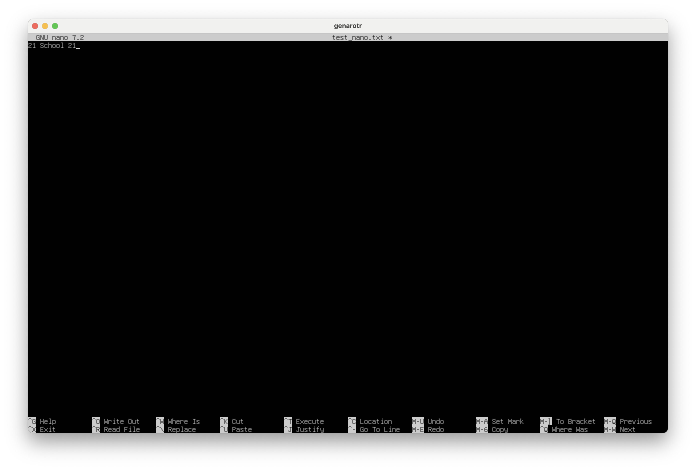

**Результат поиска:**

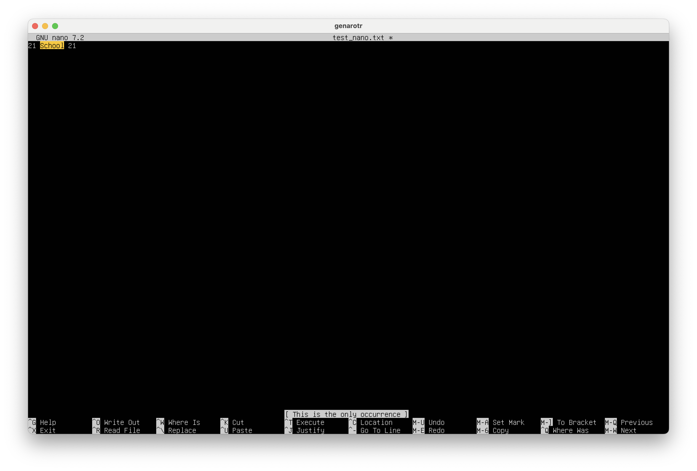

**Ввод для замены:**

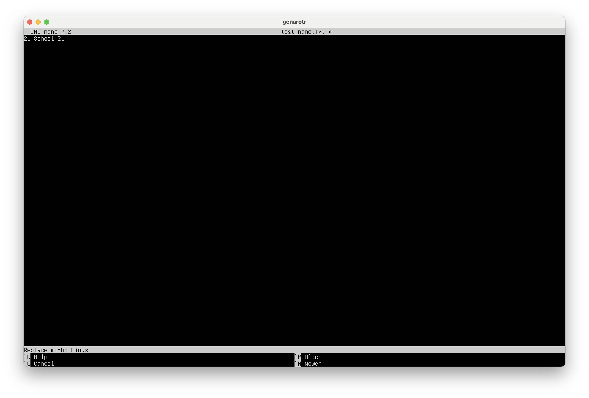

### MCEdit

- Файл: `test_mcedit.txt`.
- Выход с сохранением: F2 → F10.
- Выход без сохранения: F10 → отказ от сохранения.
- Поиск: F7 → `School` → Enter.
- Замена: F4 → указал `School` и `Linux` → подтвердил замену.

**Создание файла:**

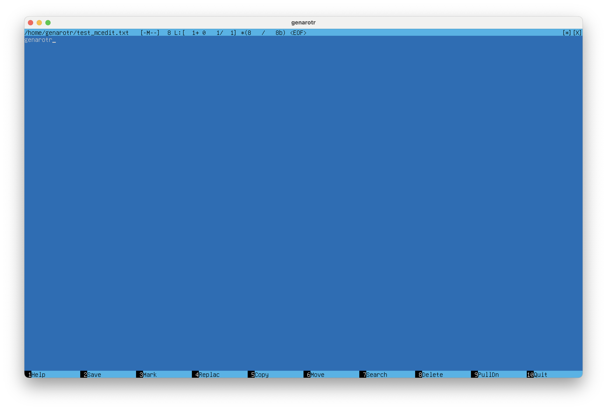

**Изменение перед выходом без сохранения:**

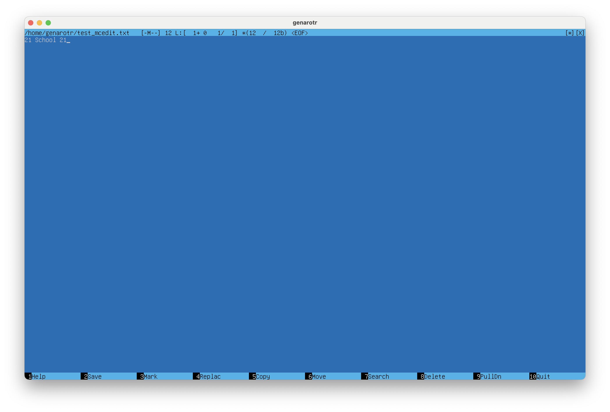

**Результат поиска:**

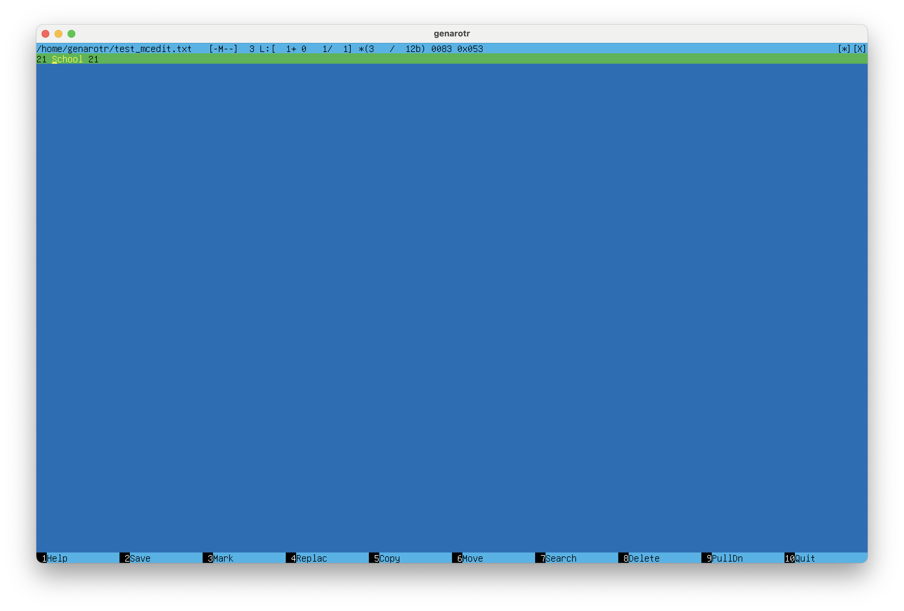

**Диалог замены:**

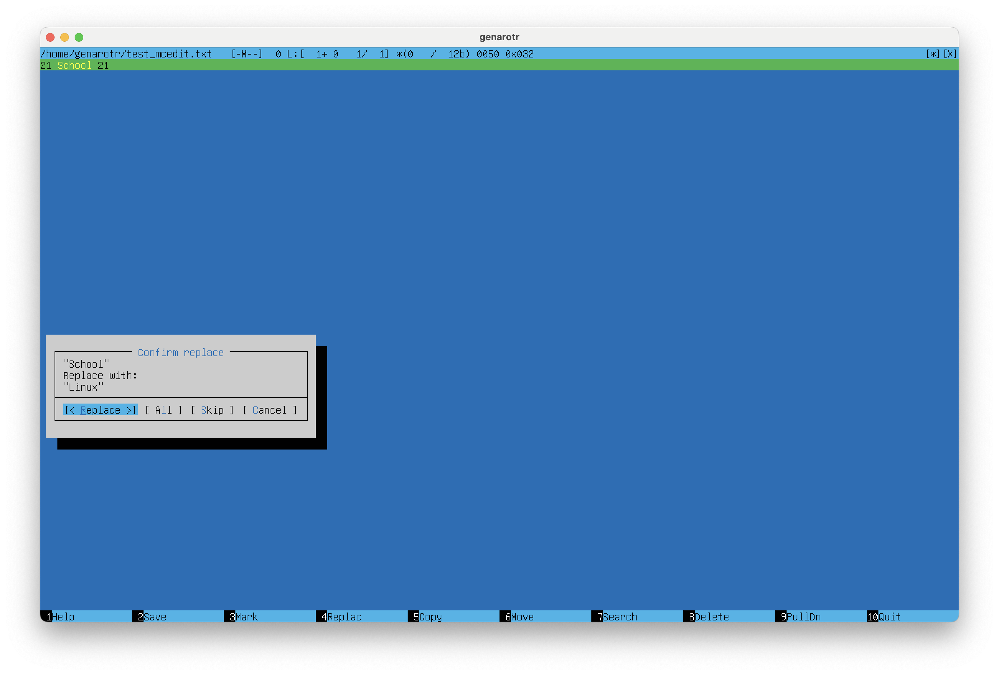

## Part 8. Установка и базовая настройка сервиса SSHD

- Установил SSH-сервер и утилиту netstat командой `sudo apt install openssh-server net-tools`.
- В файле `/etc/ssh/sshd_config` указал `Port 2022` и `ListenAddress 0.0.0.0`.
- Проверил конфигурацию командой `sudo sshd -t`. Ошибок не обнаружено.
- Отключил запуск через сокет командой `sudo systemctl disable --now ssh.socket`. Включил автостарт службы командой `sudo systemctl enable ssh` и перезапустил её командой `sudo systemctl restart ssh`.
- Командой `ps -ef | grep sshd` проверил наличие процесса sshd.
- Перезагрузил систему командой `sudo reboot`. Повторно проверил процесс и выполнил `netstat -tan`: порт `2022` находится в состоянии `LISTEN`.

**Команда `ps -ef | grep sshd`:**

- `ps` — выводит информацию о процессах.
- `-e` — показывает все процессы.
- `-f` — включает подробный формат вывода.
- `|` — передаёт вывод следующей команде.
- `grep sshd` — отбирает строки, содержащие `sshd`.

**Ключи `netstat -tan`:**

- `-t` — TCP-сокеты.
- `-a` — все сокеты, включая прослушивающие.
- `-n` — адреса и порты в числовом виде.

**Столбцы вывода:**

- `Proto` — протокол.
- `Recv-Q` — очередь приёма.
- `Send-Q` — очередь отправки. Для слушающих TCP-сокетов очереди относятся к ожидающим подключениям и пределу очереди; для установленных соединений — к непрочитанным и неподтверждённым байтам.
- `Local Address` — локальный адрес и порт.
- `Foreign Address` — адрес и порт удалённой стороны.
- `State` — состояние сокета. `LISTEN` означает ожидание подключений.

`0.0.0.0:2022` означает прослушивание порта `2022` на всех локальных IPv4-адресах. `0.0.0.0:*` в столбце удалённого адреса означает, что конкретная удалённая сторона не задана.

## Part 9. Установка и использование утилит top, htop

Утилиты top и htop уже были установлены. Запустил их командами `top` и `htop`.

### Данные из top

На момент первого наблюдения:

- Uptime: 37 минут.
- Количество авторизованных пользователей: 1.
- Средняя загрузка системы за 1, 5 и 15 минут: 0.00, 0.00, 0.00.
- Общее количество процессов: 99, из них 2 выполняются и 97 спят.
- Загрузка CPU: 0.2%, простой — 99.8%.
- Использование оперативной памяти: 282.8 MiB из 3902.0 MiB — примерно 7.2%.
- Использование swap: 0 MiB.

После сортировки по памяти (`Shift + M`) определил процесс с наибольшим потреблением памяти: `multipathd`, PID 337, RES — 26240 KiB, доля памяти — 0.7%.

После сортировки по накопленному процессорному времени (`Shift + T`) определил процесс с наибольшим значением TIME+: `kworker/1:0-events`, PID 25, TIME+ — 0:01.15, то есть 1.15 секунды.

Показатели получены в разные моменты работы top, поэтому uptime и количество процессов между наблюдениями изменялись.

### Работа с htop

Для выбора поля сортировки использовал меню `F6 (SortBy)`.

**Сортировка по PID — идентификатору процесса:**

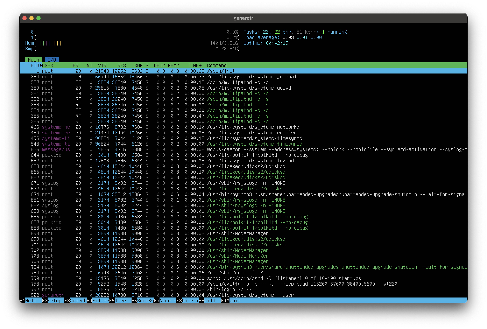

**Сортировка по PERCENT_CPU — текущему проценту использования CPU:**

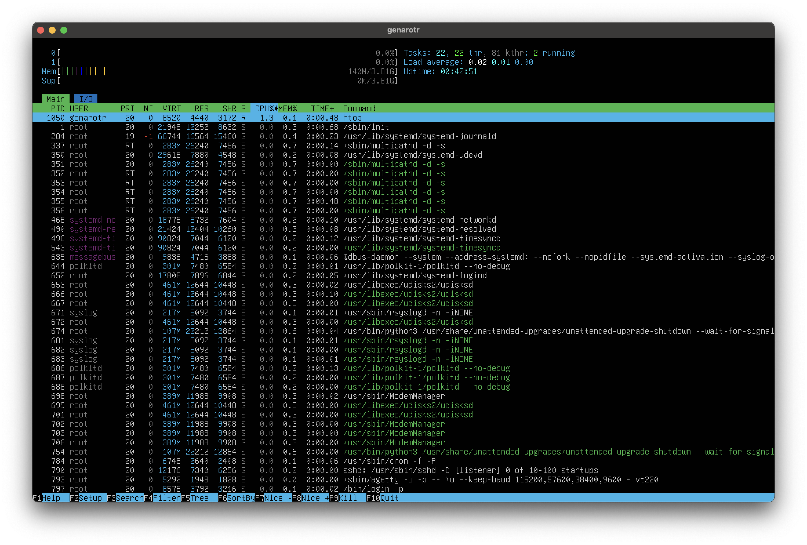

**Сортировка по PERCENT_MEM — проценту использования оперативной памяти:**

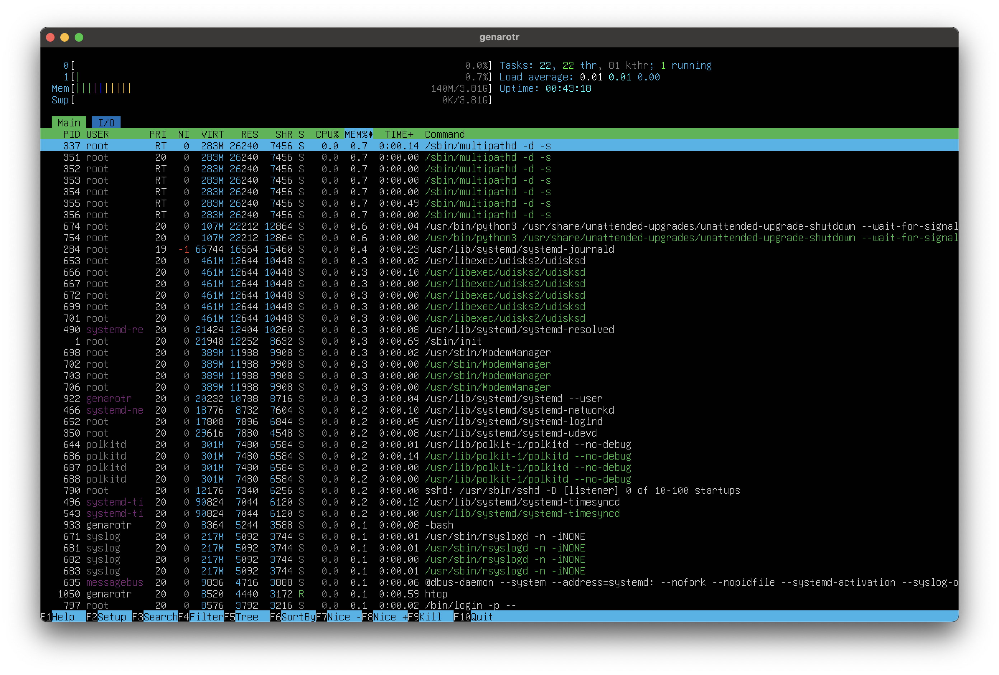

**Сортировка по TIME — накопленному процессорному времени:**

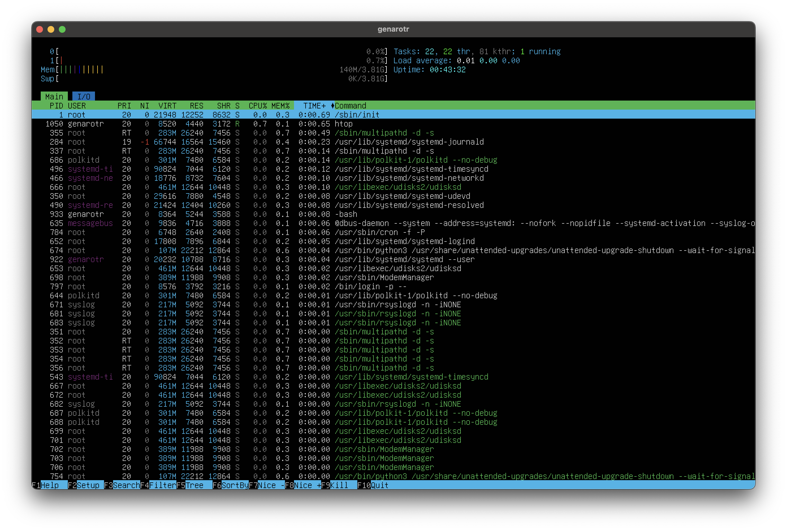

Через `F4 (Filter)` ввёл `sshd`. В списке остался процесс SSH-сервера с PID 790.

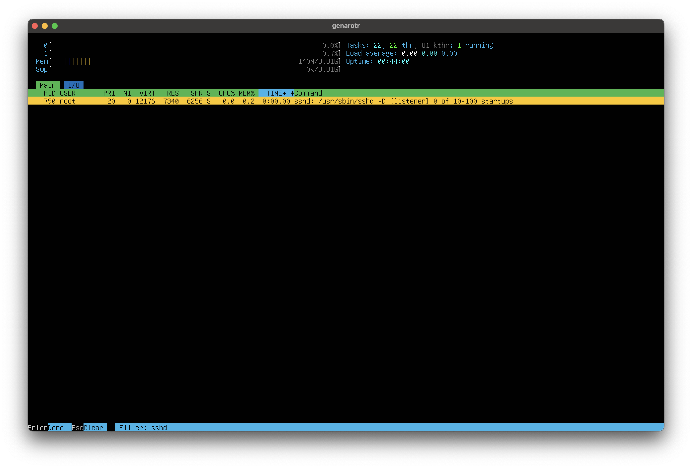

Через `F3 (Search)` ввёл `syslog`. Найден процесс `rsyslogd` с PID 671, работающий от пользователя `syslog`.

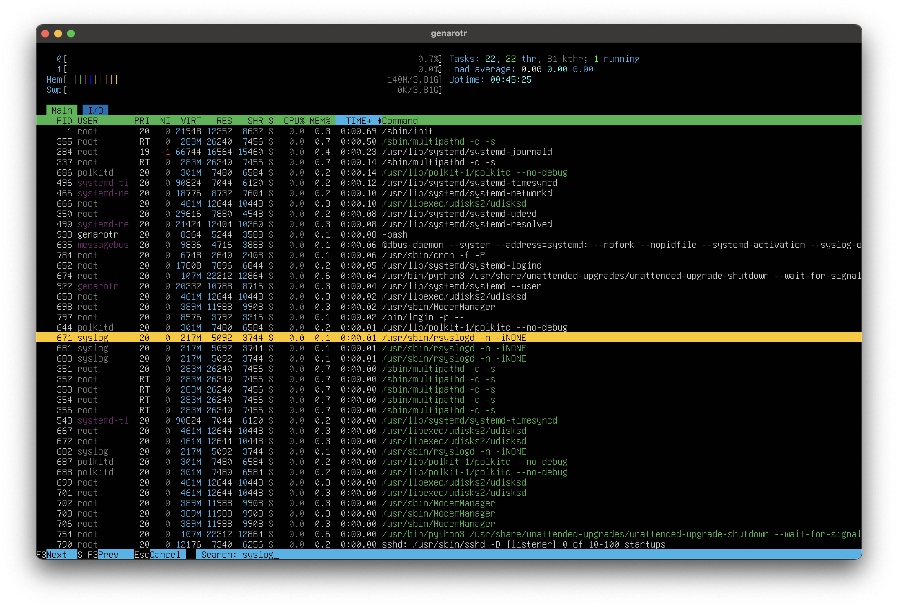

В настройках `F2 (Setup)` в разделе `Meters` добавил показатели `Hostname`, `Clock` и `Uptime`.

На скриншоте отображаются имя компьютера `user-1`, текущее время `16:47:00` и время работы системы `00:48:10`.

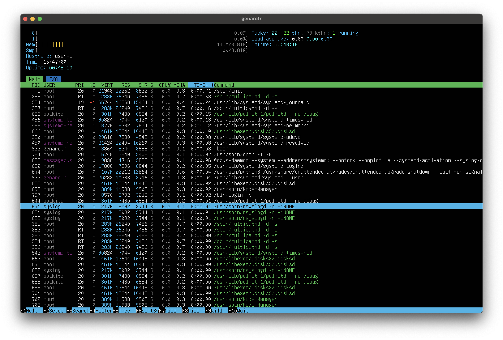

## Part 10. Использование утилиты fdisk

Выполнил команду `sudo fdisk -l` для просмотра информации о дисках и разделах.

- Название диска: `/dev/vda`.
- Размер диска: 40 GiB (42 949 672 960 байт).
- Количество секторов: 83 886 080.
- Размер сектора: 512 байт.

Размер swap определил командой `swapon --show`:

- Файл подкачки: `/swap.img`.
- Размер swap: примерно 3.8 GiB.
- На момент проверки использовано: 0 B.

## Part 11. Использование утилиты df

Выполнил команды `df` и `df -Th`.

Корневая файловая система `/` расположена на логическом томе `/dev/mapper/ubuntu--vg-ubuntu--lv`.

### Вывод df

- Размер: 18 889 392 KiB.
- Занято: 7 287 808 KiB.
- Доступно: 10 616 704 KiB.
- Процент использования: 41%.

Единица измерения — блок размером 1024 байта (`1K-blocks`), то есть KiB.

### Вывод df -Th

- Размер: 19 G.
- Занято: 7.0 G.
- Доступно: 11 G.
- Процент использования: 41%.
- Тип файловой системы: ext4.

Флаг `-T` показывает тип файловой системы, а `-h` выводит размеры в удобном для чтения виде. Обозначение `G` соответствует GiB (1024³ байт); значения округлены.

## Part 12. Использование утилиты du

Запустил команду `du`. Она показала объём дискового пространства, занимаемый текущей папкой и её подпапками, в блоках по 1024 байта.

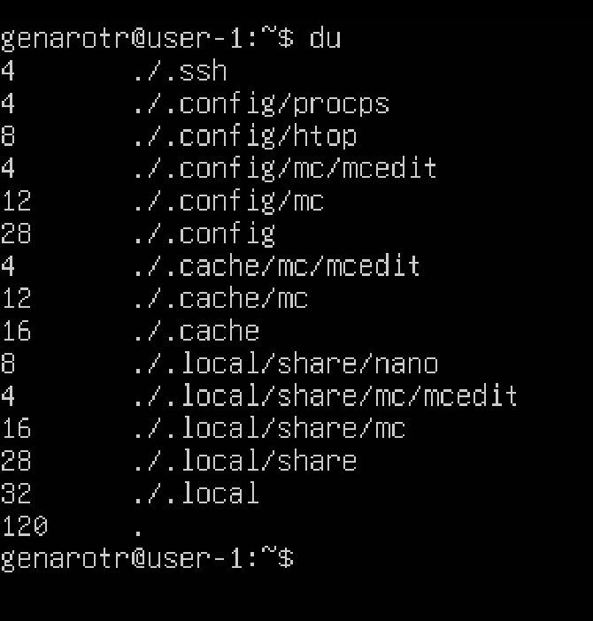

Для получения размеров в байтах выполнил отдельно:

- `sudo du -s -B1 /home`
- `sudo du -s -B1 /var`
- `sudo du -s -B1 /var/log`

Флаг `-s` выводит итоговый размер папки, а `-B1` задаёт единицу вывода — один байт.

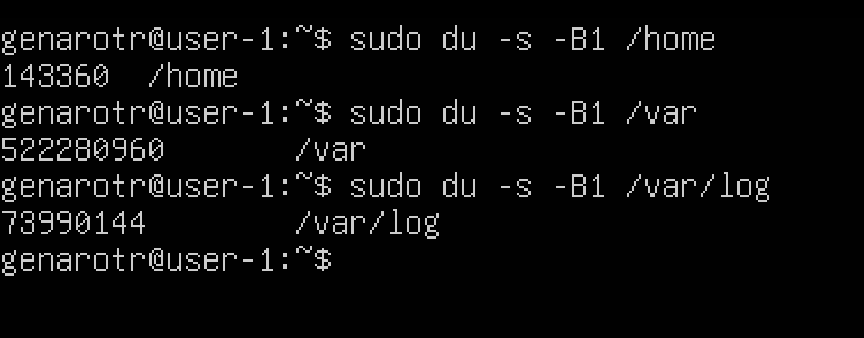

Для получения размеров в человекочитаемом виде выполнил:

- `sudo du -sh /home`
- `sudo du -sh /var`
- `sudo du -sh /var/log`

Флаг `-h` выводит размеры с обозначениями K, M и G.

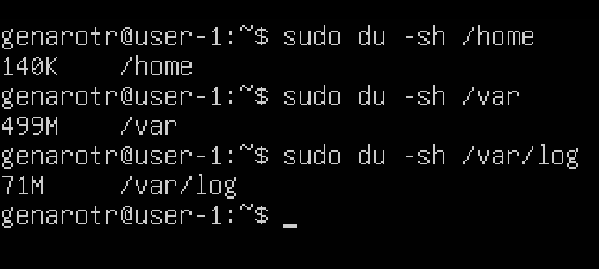

Для просмотра размера каждого элемента внутри `/var/log` выполнил команду `sudo du -sh /var/log/*`.

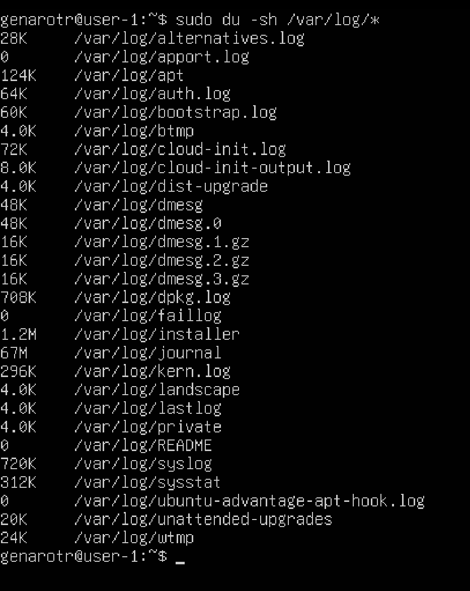

## Part 13. Установка и использование утилиты ncdu

Установил утилиту командой `sudo apt install ncdu`.

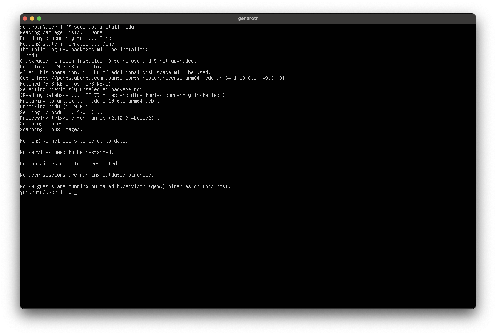

Для просмотра размера `/home` выполнил `sudo ncdu /home`.

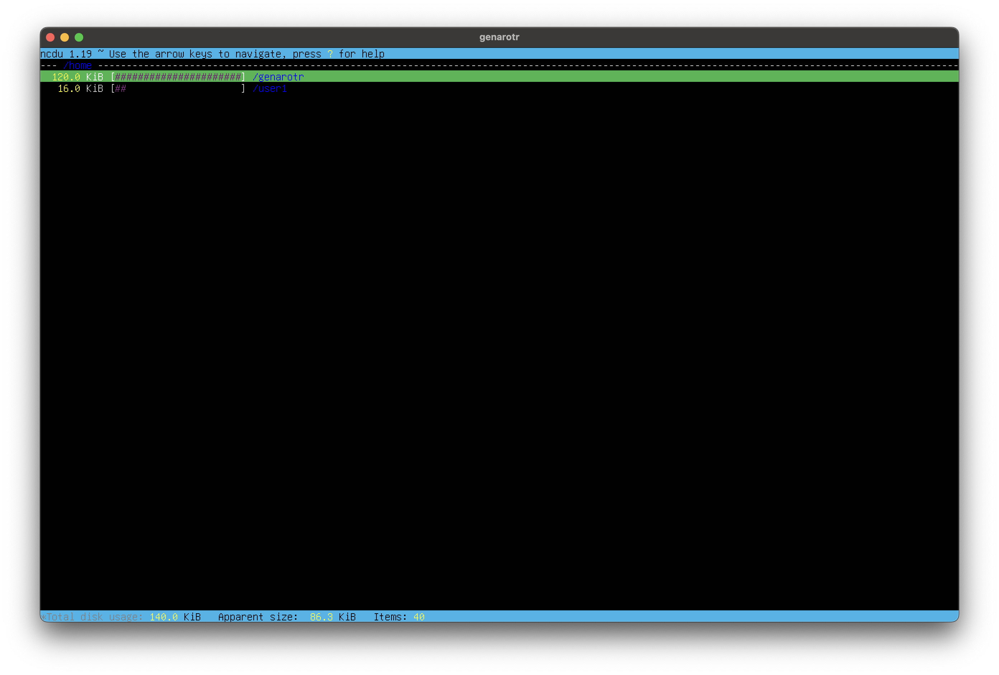

Для просмотра размера `/var` выполнил `sudo ncdu /var`.

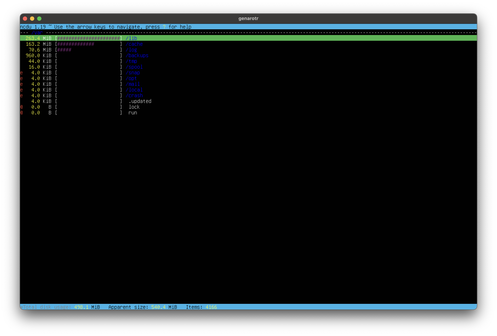

Для просмотра размера `/var/log` выполнил `sudo ncdu /var/log`.

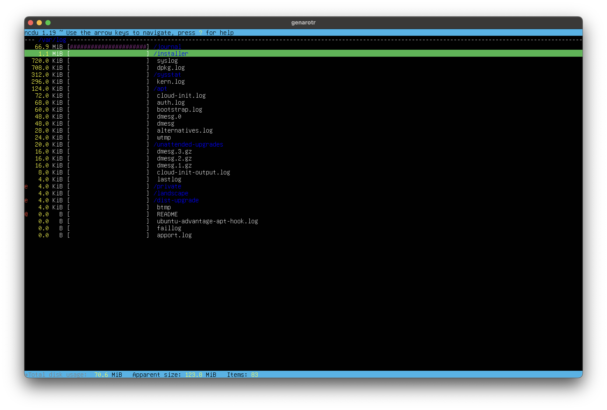

## Part 14. Работа с системными журналами

Открыл для просмотра системные журналы:

- `sudo less /var/log/dmesg` — сообщения ядра и оборудования.
- `sudo less /var/log/syslog` — общие системные события.
- `sudo less /var/log/auth.log` — события авторизации.

По журналу авторизации определил последний успешный вход:

- Дата и время: 14 октября 2026 года, 17:30:25 (UTC+3).
- Пользователь: genarotr.
- Метод входа: SSH с аутентификацией по паролю.
- IP-адрес клиента: 192.168.64.1.

Успешный вход подтверждается сообщением `Accepted password for genarotr`.

Перезапустил службу SSH командой `sudo systemctl restart ssh`.

Для просмотра журнала службы выполнил `sudo journalctl -u ssh`.

14 октября в 18:42:09 в журнале появились сообщения `Stopped ssh.service` и `Started ssh.service`, подтверждающие остановку и последующий запуск службы. После перезапуска сервер слушает порт 2022 на адресе 0.0.0.0.

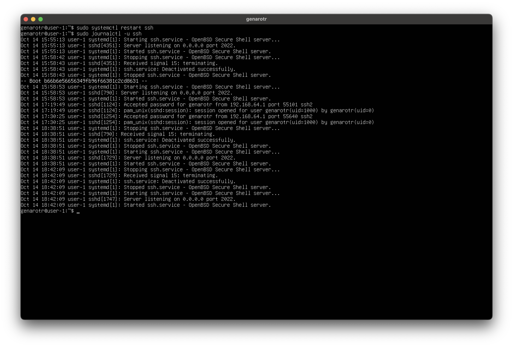

## Part 15. Использование планировщика заданий CRON

Через `crontab -e` добавил задание:

    */2 * * * * /usr/bin/uptime

Команда `uptime` запускается каждые две минуты.

Вывел список текущих заданий командой `crontab -l`.

Командой `grep uptime /var/log/syslog` нашёл записи о запуске задания.

Удалил все задания пользователя командой `crontab -r`.

Повторно выполнил `crontab -l`.

