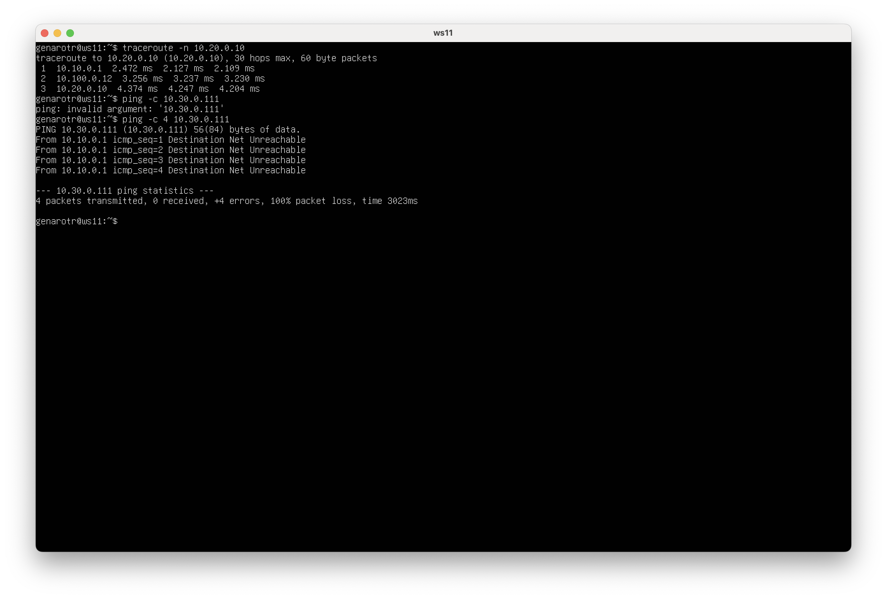
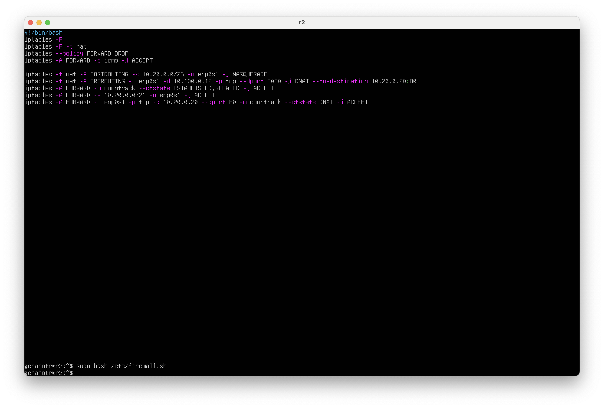

# Linux Network Lab

Практический проект по настройке сетей в Linux, выполненный в рамках обучения в «Школе 21».

Развернул основную учебную сеть из пяти виртуальных машин — трёх рабочих станций и двух маршрутизаторов. Настроил статическую маршрутизацию, DHCP, фильтрацию трафика, NAT и SSH-туннели. Ход работы и результаты проверок собраны в [полном отчёте со скриншотами](docs/report.md).

## Что реализовано

| Направление | Практическая работа | Инструменты |
| --- | --- | --- |
| IPv4 и подсети | Расчёт адресов сетей, масок и диапазонов хостов, разбор частных и loopback-адресов | ipcalc |
| Статическая маршрутизация | Связь двух машин, временные маршруты и сохранение настроек после перезагрузки | ip, Netplan, ping |
| Пропускная способность | Измерение скорости TCP-передачи между виртуальными машинами | iperf3 |
| Сетевой экран | Разрешение SSH и HTTP, проверка порядка правил и блокировки ICMP echo-reply | iptables, ping, nmap |
| Маршрутизация сети | Связь трёх подсетей через два роутера, пересылка IPv4 и маршруты по умолчанию | Netplan, sysctl, ip |
| Диагностика | Построение пути пакетов и анализ ответов ICMP | traceroute, tcpdump |
| DHCP | Динамическая выдача адресов, привязка IP к MAC и обновление аренды | isc-dhcp-server, networkctl |
| NAT | Маскирование локальных адресов и проброс TCP-порта 8080 на веб-сервер | iptables, Apache, telnet |
| SSH-туннели | Доступ к Apache на localhost через локальную и обратную переадресацию портов | OpenSSH, telnet, tmux |

## Среда

- Виртуальные машины UTM на Mac с Apple Silicon.
- Ubuntu Server 24.04 LTS, архитектура ARM64, без графического интерфейса.
- Основная сеть в частях 5–8 состоит из пяти виртуальных машин.

| Машина | Роль | Адреса в основной сети |
| --- | --- | --- |
| ws11 | Рабочая станция | 10.10.0.2/18 |
| ws21 | Рабочая станция | 10.20.0.10/26 в части 5, затем 10.20.0.2/26 по DHCP |
| ws22 | Рабочая станция и веб-сервер Apache | 10.20.0.20/26 |
| r1 | Маршрутизатор и DHCP-сервер для ws11, веб-сервер Apache для проверки NAT | 10.10.0.1/18 и 10.100.0.11/16 |
| r2 | Маршрутизатор, DHCP-сервер для ws21 и узел NAT | 10.100.0.12/16 и 10.20.0.1/26 |

В частях 1–4 отчёта использованы обозначения ws1 и ws2. На них выполнены начальные задания по IPv4, маршрутизации между двумя узлами, iperf3 и фаерволу.

Основная сеть объединяет три подсети. Маршрутизатор r1 связывает сеть ws11 с транзитным сегментом, а r2 — транзитный сегмент с сетью ws21 и ws22.

```text
ws11 ── 10.10.0.0/18 ── r1 ── 10.100.0.0/16 ── r2 ── 10.20.0.0/26 ── ws21, ws22
```

## Результаты проверок

Статические маршруты обеспечили связь между рабочими подсетями. В трассировке от ws11 до ws21 видны r1, r2 и конечный узел. Захват tcpdump показал ответы ICMP Time Exceeded и Port Unreachable. В части 3 при измерении через iperf3 между ws1 и ws2 получена скорость 3,70 Гбит/с, повторных передач TCP — 0.

DHCP выдал ws21 адрес 10.20.0.2/26, а ws11 получил закреплённый за MAC адрес 10.10.0.2/18. После запроса обновления аренды время её действия увеличилось с 333 до 576 секунд.

При политике FORWARD DROP проверка ping от r1 до ws22 завершилась со 100% потерь. После разрешения ICMP получены четыре ответа из четырёх. Проверки NAT через telnet подтвердили TCP-подключения от ws22 к Apache на r1 и от r1 через порт 8080 на r2 к Apache на ws22.

После перевода Apache на localhost настроены два SSH-туннеля. На ws21 выполнено подключение к локальному порту 8081, на ws11 — к порту 8888 обратного туннеля. В отчёте показаны команды создания туннелей и результаты TCP-подключений через telnet.

### Маршрутизация и проверка ICMP



### NAT и правила пересылки на r2



## Материалы

- [Полный отчёт — 8 частей](docs/report.md)
- [Скриншоты выполнения](docs/img)
- [Локальный SSH-туннель и проверка подключения](docs/report.md#part-8-ssh-туннели)

Адреса и имена интерфейсов в отчёте относятся к моей учебной сети. Конфигурации и проверки показаны последовательно по этапам работы, включая переход со статических адресов на DHCP и изменение адреса прослушивания Apache.

## Чему научился

Получил практику настройки маршрутизации между подсетями, фильтрации пакетов и преобразования адресов. Научился сопоставлять таблицы маршрутизации, правила фаервола и захват трафика при диагностике связи. Разобрался в выдаче DHCP-аренды и направлении передачи данных через локальные и обратные SSH-туннели.
